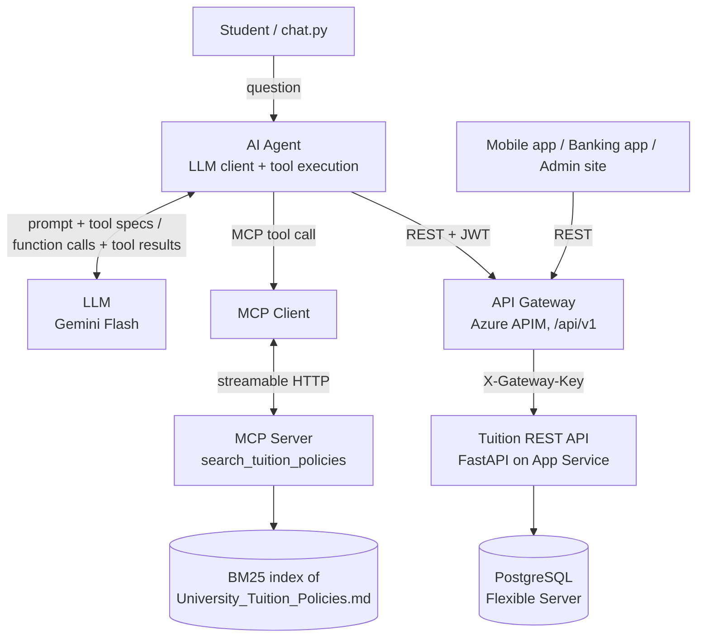

# University Tuition Assistant

SE 4458 Software Architecture & Design of Modern Large Scale Systems – Midterm 1 (Group 1)

A conversational assistant for students asking about tuition deadlines, installment
eligibility, payment rules, balances and payments. The AI Agent uses real LLM tool calling
(Gemini) to decide whether to search the policy document through the **MCP server**, call
the **Tuition REST API through the API Gateway**, or both, and then answers from the tool
results with policy section references.

## Links

| What | Where |
|---|---|
| Source code | GITHUB_REPO_URL |
| Demo video | VIDEO_URL |
| API Gateway (all REST calls) | https://tuition-apim-ee7141.azure-api.net/api/v1 |
| Swagger UI of the Tuition API | https://tuition-api-ee7141.azurewebsites.net/docs |
| OpenAPI specification | https://tuition-api-ee7141.azurewebsites.net/openapi.json |
| MCP server (streamable HTTP) | https://tuition-mcp-ee7141.azurewebsites.net/mcp |
| ER diagram | [docs/er-diagram.md](docs/er-diagram.md) |
| Gateway routes, policy, checks | [gateway/README.md](gateway/README.md) |
| MCP tool schema + indexing | [mcp-server/README.md](mcp-server/README.md) |
| Agent details | [agent/README.md](agent/README.md) |
| API details, auth, unit tests | [tuition-api/README.md](tuition-api/README.md) |

## Components

| Folder | What it is |
|---|---|
| `tuition-api/` | Tuition REST API (FastAPI, SQLAlchemy) + PostgreSQL, JWT auth, 75 unit tests |
| `mcp-server/` | MCP server (MCP Python SDK 2.x): indexes `University_Tuition_Policies.md` once at startup (BM25) and exposes `search_tuition_policies`, 41 tests |
| `agent/` | AI Agent, command line chat: Gemini tool calling, MCP client, REST client (through the gateway), payment confirmation, tool trace, 36 tests |
| `gateway/` | Azure API Management policy and route mappings |
| `deploy/` | PowerShell + Azure CLI scripts for the whole cloud setup |
| `docs/` | ER diagram, test outputs, agent scenario traces, screenshots |

## Architecture



- The LLM only chooses tools; the agent executes them and sends the results back. The LLM
  never calls a backend itself. There is no keyword routing.
- The MCP path and the gateway path are separate: policy search goes to the MCP server,
  live records and payments go through the gateway to the REST API.
- The policy document is indexed once when the MCP server starts, not per question.

### Design decisions

- **Layered, service oriented API**: controllers (`app/api/v1`) → service interface
  (`TuitionService`) + implementation → repositories → SQLAlchemy models. DTOs are separate
  from the database models, the service is injected with FastAPI `Depends` (easy to replace
  with a fake in tests).
- **Versioning**: every route is under `/api/v1` in the code and in APIM. A breaking change
  would be a new `v2` router + a new `api/v2` api on the gateway.
- **Route groups per client** (`/mobile`, `/banking`, `/admin`) so auth and limits can be set
  per group on the gateway and in the api.
- **Stateless**: JWT auth, no server session. The MCP server also runs in stateless HTTP mode.
- **Performance**: `paid_amount` is stored on the tuition row (updated in the same
  transaction as the payment), so "unpaid tuition status" is one indexed query with paging
  instead of summing payments per student. Paging is limited to 100 rows per page. Money is
  `NUMERIC(12,2)`, never float.
- **Consistency**: payments lock the tuition row (`SELECT ... FOR UPDATE`) and
  `transaction_id` is unique, so retries or parallel requests can not pay twice.
- **Security in two layers**: the gateway checks the JWT and the role, the api checks them
  again plus the student number. The api only accepts `/api` calls that carry the gateway's
  secret header, so the gateway can not be skipped.

## API operations

| Client | Operation | Route (gateway) | Auth | Paging |
|---|---|---|---|---|
| Mobile app | Query Tuition | `GET /api/v1/mobile/tuitions/{studentNo}?term=` | no (3 per student per day) | no |
| Banking app | Query Tuition | `GET /api/v1/banking/tuitions/{studentNo}?term=` | BANK or STUDENT (own number) | no |
| Banking app | Pay Tuition | `POST /api/v1/banking/payments` | BANK or STUDENT (own number) | no |
| Admin site | Add Tuition | `POST /api/v1/admin/tuitions` | ADMIN | no |
| Admin site | Add Tuition – Batch (CSV) | `POST /api/v1/admin/tuitions/batch` | ADMIN | no |
| Admin site | Unpaid Tuition Status | `GET /api/v1/admin/tuitions/unpaid?term=&page=&pageSize=` | ADMIN | yes |
| all | Login / who am I | `POST /api/v1/auth/token`, `GET /api/v1/auth/me` | – / token | no |

Query Tuition returns every term of the student **and** the overall total; `term` is optional.
Errors always have the format `{"code", "message", "details"}`; the codes are listed in
[tuition-api/README.md](tuition-api/README.md#error-format).

## AI Agent

Tools given to the LLM:

| Tool | Runs | 
|---|---|
| `search_tuition_policies(query, top_k?)` | MCP server |
| `query_tuition(term?)` | `GET /banking/tuitions/{studentNo}` through the gateway with the student's token |
| `pay_tuition(term, amount)` | `POST /banking/payments` through the gateway, **only after the user types `yes`** |

- The student logs in; the student number comes from `/auth/me`. It is **not** a tool
  parameter, so a number written in the prompt can not be used to read another student's data
  (and the api would answer 403 anyway).
- Before a payment the agent reads the current balance again, shows student, term, amount,
  balance and deadline, and asks for `yes`. Anything else cancels and the api is not called.
  A new `transactionId` (`AGENT-<uuid>`) is used as idempotency key.
- Every question prints a tool trace (tool, input, short result) and is written to
  `agent/logs/trace-<date>.jsonl`.

## Demonstration and evidence

| Required | Evidence |
|---|---|
| 3 agent scenarios (MCP only, API only, combined) with tool traces | [docs/agent-scenarios.md](docs/agent-scenarios.md), screenshots in [docs/screenshots](docs/screenshots) |
| Confirmed simulated payment | [docs/agent-scenarios.md](docs/agent-scenarios.md#4-payment-with-explicit-confirmation) (500.00 for 2026-FALL, remaining 2500.00) |
| 3 distinct MCP retrieval tests | [docs/mcp-retrieval-tests.txt](docs/mcp-retrieval-tests.txt) |
| Protected gateway route + error response | [gateway/README.md](gateway/README.md#checked-on-the-deployed-gateway) |
| Unit tests run | [docs/unit-test-results.txt](docs/unit-test-results.txt) and the commands below |

Agent scenarios (run against the deployed gateway and MCP server, `gemini-3.5-flash-lite`):

| Question | Tools chosen by the LLM | Answer (short) |
|---|---|---|
| When is the payment deadline? | `search_tuition_policies` | Fall 2026: Sep 30, 2026 (Section 2.1), Spring 2027: Feb 15, 2027 (Section 2.2) |
| What is my balance? | `query_tuition` | 6000.00 USD (2026-FALL 3000.00, 2027-SPRING 3000.00) |
| Can I pay my outstanding balance in installments? | `search_tuition_policies` + `query_tuition` | balance ≥ $300 → may request up to 3 installments, subject to approval (Sections 3.1, 3.4) |
| Pay 500 for the fall term | `pay_tuition` (after `yes`) | SUCCESS, remaining 2500.00 |

## Test data and how to reproduce

Test accounts (created by `python -m app.seed`, test passwords only):

| username | password | role |
|---|---|---|
| `20210001` … `20210004` | `student123` | STUDENT |
| `bank` | `bank123` | BANK |
| `admin` | `admin123` | ADMIN |

| Student | Term | Tuition | Paid (seed) | Note |
|---|---|---|---|---|
| 20210001 Ayse Yilmaz | 2026-FALL / 2027-SPRING | 3000 / 3000 | 0 | example of the assignment |
| 20210002 Mehmet Demir | 2026-FALL | 2500 | 2500 | fully paid |
| 20210003 Zeynep Kaya | 2026-FALL | 4000 | 1000 | partially paid |
| 20210004 Can Ozturk | 2026-FALL | 250 | 0 | below the $300 installment limit |

(On Azure 20210001 has the 500.00 demo payment for 2026-FALL.)

### Against the deployed system

```
# 1. login through the gateway
curl -X POST https://tuition-apim-ee7141.azure-api.net/api/v1/auth/token -d "username=20210001&password=student123"

# 2. protected route with the token -> 200, without token -> 401 from the gateway
curl -H "Authorization: Bearer <token>" https://tuition-apim-ee7141.azure-api.net/api/v1/banking/tuitions/20210001
curl https://tuition-apim-ee7141.azure-api.net/api/v1/banking/tuitions/20210001

# 3. another student's number with 20210001's token -> 403
curl -H "Authorization: Bearer <token>" https://tuition-apim-ee7141.azure-api.net/api/v1/banking/tuitions/20210003

# 4. mobile query, the 4th call on the same day -> 429 (try 20210004)
curl https://tuition-apim-ee7141.azure-api.net/api/v1/mobile/tuitions/20210004

# 5. calling the app service directly (skipping the gateway) -> 403
curl https://tuition-api-ee7141.azurewebsites.net/api/v1/mobile/tuitions/20210004
```

The agent against the deployed system:

```
cd agent
python -m venv .venv
.venv\Scripts\activate
pip install -r requirements.txt
copy .env.example .env
# in .env: GEMINI_API_KEY=<your key>, GATEWAY_BASE_URL=https://tuition-apim-ee7141.azure-api.net/api/v1,
#          MCP_SERVER_URL=https://tuition-mcp-ee7141.azurewebsites.net/mcp
python chat.py          # log in as 20210001 / student123 and ask the questions above
```

## Running locally

Needs Python 3.12+ and a local PostgreSQL.

```
# 1. Tuition API  (http://localhost:8000/docs)
cd tuition-api
python -m venv .venv && .venv\Scripts\activate
pip install -r requirements.txt
copy .env.example .env            # set DATABASE_URL
python -m app.seed                # tables + test data (--reset to start over)
uvicorn app.main:app --port 8000

# 2. MCP server  (http://localhost:8001/mcp)
cd mcp-server
python -m venv .venv && .venv\Scripts\activate
pip install -r requirements.txt
python server.py

# 3. Agent
cd agent
python -m venv .venv && .venv\Scripts\activate
pip install -r requirements.txt
copy .env.example .env            # GEMINI_API_KEY, GATEWAY_BASE_URL=http://localhost:8000/api/v1, MCP_SERVER_URL=http://localhost:8001/mcp
python chat.py
```

Locally the api runs without the gateway (`GATEWAY_KEY` is empty, so the gateway header check
is off).

## Unit tests

Every service has its own pytest suite. None of them needs a database server, Azure or a real
LLM (the API uses an in-memory SQLite copy of the seed data, the agent uses a fake LLM, fake
API and fake MCP client).

```
cd tuition-api && .venv\Scripts\activate && pytest     # 75 tests
cd mcp-server  && .venv\Scripts\activate && pytest     # 41 tests
cd agent       && .venv\Scripts\activate && pytest     # 36 tests
```

Every API operation has at least one success and one failure / edge case test; the table is in
[tuition-api/README.md](tuition-api/README.md#unit-tests). Output of the last API run:
[docs/unit-test-results.txt](docs/unit-test-results.txt).

## Cloud deployment (Azure)

| Part | Azure service | URL / region |
|---|---|---|
| API Gateway | API Management, Consumption | https://tuition-apim-ee7141.azure-api.net/api/v1 (France Central) |
| Tuition API | App Service (Linux, Python 3.12, F1) | https://tuition-api-ee7141.azurewebsites.net (Austria East) |
| MCP server | App Service (same F1 plan) | https://tuition-mcp-ee7141.azurewebsites.net/mcp (Austria East) |
| Database | PostgreSQL Flexible Server, Burstable B1ms, 32 GB, PostgreSQL 17 | `tuition-pg-ee7141` (Poland Central) |

The Swagger page of the api sends its "Try it out" requests to the gateway (the api itself
refuses `/api` calls that do not come through the gateway).

Scripts are in [`deploy/`](deploy). They need the [Azure CLI](https://learn.microsoft.com/cli/azure/install-azure-cli-windows) and `az login`.

```
# 1) create postgres, app service plan and the api web app (once)
powershell -ExecutionPolicy Bypass -File .\deploy\azure-create.ps1 -Suffix <your-suffix>

# 2) deploy the api, the first time also create the tables + test data
powershell -ExecutionPolicy Bypass -File .\deploy\azure-deploy-api.ps1 -Seed

# 3) API gateway: APIM, named values, api import from openapi.json, policy
powershell -ExecutionPolicy Bypass -File .\deploy\azure-gateway.ps1

# 4) MCP server as a second web app
powershell -ExecutionPolicy Bypass -File .\deploy\azure-deploy-mcp.ps1
```

- generated passwords, JWT secret and gateway key are saved in `deploy/azure-secrets.local.env` (not in git)
- api app settings: `DATABASE_URL` (with `sslmode=require`), `JWT_SECRET`, `GATEWAY_KEY`, `PUBLIC_BASE_URL`, `SCM_DO_BUILD_DURING_DEPLOYMENT=true` (azure installs `requirements.txt`)
- startup commands: api `python -m uvicorn app.main:app --host 0.0.0.0 --port 8000`, MCP `python server.py`
- postgres firewall: azure services + the ip of the computer that runs the seed script
- why three regions: the Azure for Students subscription only allows five regions, the free
  F1 plan had quota only in Austria East and the postgres B1ms sku could only be created in
  Poland Central (see Issues)
- the agent is a command line program and runs on the user's computer, it is not deployed

## LLM cost

- Model: Google Gemini `gemini-3.5-flash-lite` through the Gemini Developer API **free tier**,
  so the demo cost was **0**. One question uses 2–3 requests (question → tool call(s) →
  answer). The free tier has per-minute and per-day request limits per model.
- On the paid tier a flash-lite question is a few thousand tokens, i.e. far below one cent.
- Low cost / testable approach: the LLM sits behind a small `ChatModel` interface, so all agent
  tests run with a scripted fake model and cost nothing. Only the live demo uses the real API.

## Assumptions

- **Money**: `NUMERIC(12,2)`, values have at most 2 decimals (`10.555` is rejected, no
  rounding is done by the api). JSON returns money as strings (`"3000.00"`). One currency per
  tuition; the overall total assumes all terms are in the same currency.
- **Query Tuition** returns each term and the overall total (the assignment asks to specify
  term or overall in the contract – we return both, `term` filters).
- **Daily mobile limit**: 3 successful mobile queries per student number per day; the day
  resets at 00:00 UTC; a query for an unknown student is not counted. Banking queries are not
  limited.
- **Pay Tuition**: amount > 0 and ≤ the current balance of that term (no overpayment, policy
  7.2). A used `transactionId` is rejected with 409, even with the same amount. Rejected
  payments are not stored. Payments are simulated, no card processing. `channel` is the role of
  the payer (BANK or STUDENT).
- **Add Tuition** is create-or-update per (student, term): 201 when created, 200 when updated.
  The new amount can not be lower than the amount already paid, and the currency can not
  change after a payment. Student and term must already exist.
- **Batch CSV**: header must be exactly `studentNo,term,amount,currency`; every row is handled
  like Add Tuition in its own savepoint, so bad rows do not stop good rows; the answer has
  success / failure counts and the line number + reason of each failed row; if the same
  student and term appear twice, the later row wins. Max file size 1 MB, UTF-8.
- **Policy interpretation**: the agent explains installment rules but never promises
  approval; a partial payment is not an installment approval (policy 3.4). Installment
  amounts are not calculated by the api; the policy says equal parts with the rounding
  difference on the last installment (3.2). Late fees are only explained, not posted (4.1).
- **Identity**: a student can only see and pay their own tuition; the student number comes
  from the token. BANK can work with every student, ADMIN only uses the admin routes. The chat
  is for students only.
- **API errors**: 400 invalid input, 401 no / bad token, 403 wrong role / other student /
  skipped gateway, 404 not found, 409 duplicate transaction or conflicting update, 422 amount
  more than the balance, 429 daily limit (with `Retry-After`).
- **Deployment**: APIM Consumption tier (free, see Issues for the limit), App Service F1,
  PostgreSQL B1ms. Test data is the same seed locally and on Azure.

## Issues

- **PostgreSQL installer on a Turkish Windows**: initdb failed with
  `locale name "Turkish_Türkiye.1254" contains non-ASCII characters`. Fixed by running
  `initdb --locale=C -E UTF8` by hand and registering the service with `pg_ctl register`.
- **Azure for Students limits**: only 5 regions are allowed. The free F1 App Service plan had 0
  quota in France Central, and creating the postgres B1ms server returned `SkuNotAvailable` in
  France Central and Austria East although the sku is listed there. It worked in Poland
  Central, so the database is in a different region than the web apps.
- **APIM Consumption tier** has no `quota-by-key` / `rate-limit-by-key`, so the
  3-queries-per-student-per-day rule is counted in the api (keyed by student number) and the
  429 is passed through the gateway.
- **OpenAPI version**: FastAPI writes OpenAPI 3.1, the APIM import only accepted 3.0
  (`exclusiveMinimum` as a number, `anyOf` with `null`). `deploy/prepare_openapi.py` converts
  these parts before the import.
- **PowerShell 5.1 details**: `az` errors do not stop a script (exit codes are checked by
  hand), `Compress-Archive` may write `\` in zip paths (the zip is made with python), and
  `Get-Content` adds hidden properties that `ConvertTo-Json` sends too (the policy upload was
  "bigger than 16 KB"; fixed with `ReadAllText`).
- **MCP SDK 2.x** renamed `FastMCP` to `MCPServer`; most examples online are for 1.x.
- **MCP ranking**: the query "installment rules" first returned section 4.1 ("Late fee rule")
  because of the word "rule" in the heading. Generic words like rule / policy are now
  stopwords and the query returns 3.2, 3.3, 3.4.
- **Gemini connection**: on our network the TLS handshake with `generativelanguage.googleapis.com`
  sometimes failed a few times in a row with `[SSL: INVALID_SESSION_ID]` and then worked again.
  The agent now retries connection errors up to 5 times (1, 2, 3 ... seconds).
- **Gemini free tier quota**: `gemini-3.6-flash` allowed only 20 requests per day on the free
  tier and we used it up while testing (429 "requests per day limit exceeded"). The demo uses
  `gemini-3.5-flash-lite`, which has its own quota.
