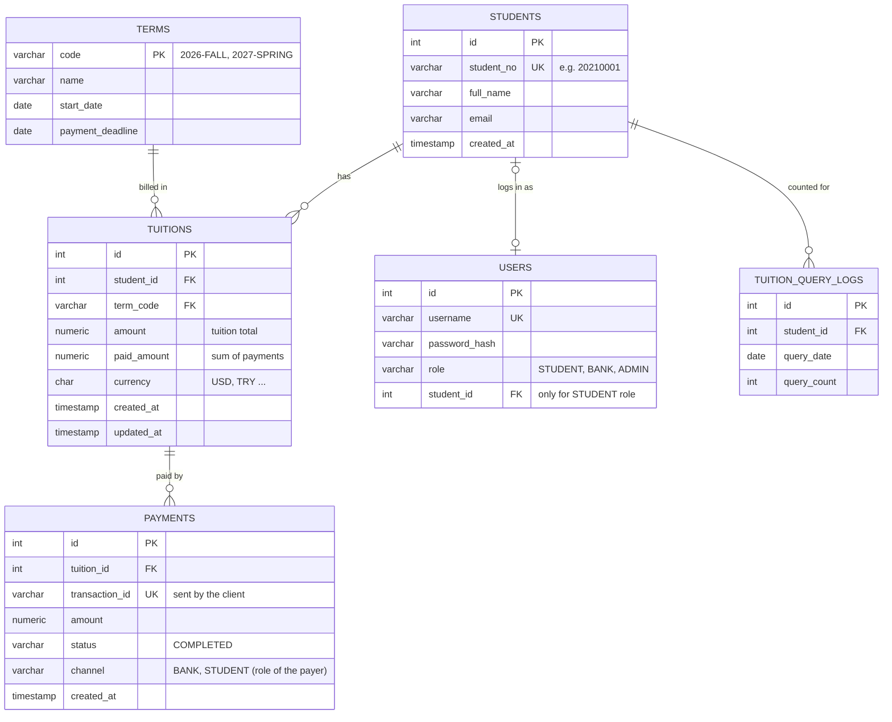

# ER / Data Model

Database: PostgreSQL. Money columns are `NUMERIC(12,2)` so there are no float rounding problems.

## Tables

### students
Students of the university. `student_no` is the number used in the APIs, `id` is only used
inside the database.

### terms
Academic billing periods. Deadlines come from the policy document (Fall 2026 → 2026-09-30,
Spring 2027 → 2027-02-15). They are seeded and not created by the APIs.

### tuitions
One row per student per term (`UNIQUE(student_id, term_code)`).
- balance = `amount - paid_amount` (calculated, not stored)
- `paid_amount` is kept in the table so the unpaid list can be filtered with one query
  (`WHERE paid_amount < amount`) instead of summing payments for every student. It is
  updated in the same transaction as the payment insert.
- index on `term_code` for the unpaid tuition status query.

### payments
Simulated payments, no real card processing.
- `transaction_id` is unique, so the same payment can not be recorded twice (idempotency).
- only successful payments are saved. Rejected ones (duplicate id, amount > balance,
  amount <= 0) return an error and are not stored.

### users
Accounts for login (JWT).
- `STUDENT` – linked to one student, can only see and pay their own tuition.
- `BANK` – banking app client, can query and pay tuition.
- `ADMIN` – university web site, can add tuition and see the unpaid list.

### tuition_query_logs
Daily counter for the mobile Query Tuition endpoint (max 3 calls per student per day).
`UNIQUE(student_id, query_date)`. The gateway also limits this by student number; keeping
it in the API too makes the rule testable without the gateway.

## Rules / assumptions

- Add Tuition: if a tuition for the same student and term exists, `amount` and `currency`
  are updated (upsert). The new amount can not be lower than the already paid amount.
- Add Tuition: the student and the term must already exist, otherwise the record fails.
- Query Tuition returns the balance of every term plus an overall total. A `term`
  parameter can be given to get only one term.
- Overpayment is not supported (policy section 7.2).
- Currency is stored per tuition. Payments are assumed to be in the same currency.
